<p align="center">
  
</p>

<p align="center">
  <a href="https://github.com/ishandutta2007/Awesome-Awesome-Awesome"></a>
  <a href="https://discord.gg/jc4xtF58Ve"></a>
  <a href="https://github.com/ishandutta2007/Awesome-Portfolio-Website-Builder/stargazers"></a>
  <a href="https://github.com/ishandutta2007/Awesome-Portfolio-Website-Builder/network/members"></a>
  <a href="https://github.com/ishandutta2007/Awesome-Portfolio-Website-Builder/blob/main/LICENSE"></a>
  <a href="https://github.com/ishandutta2007/Awesome-Portfolio-Website-Builder/pulls"></a>
  <a href="https://github.com/ishandutta2007"></a>
</p>

---

# 🌐 Awesome Portfolio Website Builder

> **A definitive, curated directory of SaaS platforms, open-source static site generators, no-code visual builders, and developer portfolio frameworks.** Focused on permanence, data ownership, high-performance web vitals, and self-hosted publishing.

Whether you are a **software engineer**, **UI/UX designer**, **creative director**, **photographer**, or **technical artist**, your portfolio website is your single most important digital calling card. This repository catalogs the best solutions available — from turnkey subscription services to 100% free, ownership-first open-source engines that can be deployed to GitHub Pages, Vercel, or custom bare-metal servers.

---

## 📑 Table of Contents

- [📈 Sector Overview & Market Dynamics](#-sector-overview--market-dynamics)
- [💼 SaaS / Hosted Portfolio Platforms](#-saas--hosted-portfolio-platforms)
- [🚀 Open-Source Portfolio Projects & Frameworks](#-open-source-portfolio-projects--frameworks)
- [🎯 Architecture & Deployment Comparison](#-architecture--deployment-comparison)
- [🔍 SEO & Discoverability Keywords](#-seo--discoverability-keywords)
- [🤝 How to Contribute](#-how-to-contribute)
- [💖 Support & Sponsoring](#-support--sponsoring)
- [⭐ Star History](#-star-history)
- [📜 License & Disclaimer](#-license--disclaimer)

---

## 📈 Sector Overview & Market Dynamics

The global website builder and digital portfolio software market is valued at approximately **$2.8 Billion in 2024** and is projected to expand to **$5.2 Billion by 2030**, reflecting a sustained Compound Annual Growth Rate (CAGR) of **~8.9%**.

The sector demonstrates **moderate fragmentation with a bifurcated concentration model**:
- **Mass-Market Concentration**: Large-cap, generalist cloud builders (such as Adobe, Wix, and Squarespace) command the dominant volume share for non-technical creators, powered by bundled creative subscriptions and massive brand equity.
- **Niche & Open-Source Fragmentation**: The specialized portfolio niche for technical, visual, and design professionals is intensely fragmented. Spurred by platform closures (notably the shutdown of Bento.me) and rising subscription costs, an accelerating proportion of developers and digital creators are turning towards **self-hosted, open-source static site generators** (built on Astro, Next.js, SvelteKit, and Tailwind CSS) where hosting is free and portfolios are immune to corporate discontinuation.

---

## 💼 SaaS / Hosted Portfolio Platforms

The table below provides a ranked overview of notable hosted SaaS portfolio builders, **sorted in descending order by company valuation / scale**.

| 🏢 Platform | 💰 Valuation / Revenue (Scale) | 🏷️ Starting Tier Price | 🎁 Free Tier / Free Trial Limits | 🎯 Target Creators & Key Highlights |
| :--- | :--- | :--- | :--- | :--- |
| **[Adobe Portfolio](https://portfolio.adobe.com/)** | **~$210B Market Cap**<br>*(Adobe Inc. / $21.5B Revenue)* | **$9.99 / month**<br>*(Photography Plan, billed annually)* | **7-day free trial** of Creative Cloud with unrestricted builder access; no permanent free plan. | **Photographers & Visual Designers**.<br>Includes Adobe Fonts integration, direct 1-click Behance synchronization, responsive galleries, and custom domain mapping. |
| **[Wix](https://www.wix.com/)** | **~$11.2B Market Cap**<br>*(Wix.com Ltd / $1.76B Revenue)* | **$17.00 / month**<br>*(Light Plan, billed annually)* | **Free forever plan** with 500MB storage, 500MB bandwidth, Wix banner ad, and `user.wixsite.com` subdomain. | **Freelancers & General Creators**.<br>Drag-and-drop visual canvas, 900+ designer templates, Wix Studio AI builder, built-in forms, and lightweight appointment booking. |
| **[Squarespace](https://www.squarespace.com/)** | **~$7.2B Valuation**<br>*(Permira / $1.11B Annual Revenue)* | **$16.00 / month**<br>*(Personal Plan, billed annually)* | **14-day free trial** with full styling and template editing; paid tier required to publish live on a custom domain. | **Designers, Agencies & Photographers**.<br>Editorial-grade typography, Fluid Engine responsive grid editing, integrated client scheduling, and built-in blogging. |
| **[Webflow](https://webflow.com/)** | **~$4.0B Valuation**<br>*(Series C / $200M+ ARR)* | **$14.00 / month**<br>*(Basic Plan, billed annually)* | **Free forever Starter plan** with 2 static pages, 50 CMS collection items, 1GB bandwidth, and `webflow.io` subdomain. | **UI/UX Designers & Dev-Designers**.<br>Visual CSS/HTML canvas, granular layout box-model control, 3D scroll animations, and semantic clean code export. |
| **[Format](https://www.format.com/)** | **~$75M Valuation**<br>*(Zenfolio Inc. / ~$30M Revenue est.)* | **$8.00 / month**<br>*(Basic Plan, billed annually)* | **14-day free trial** with up to 10 pages, full design editing, and client proofing; no credit card required. | **Commercial Photographers & Artists**.<br>Client proofing suite, photo watermarking, Lightroom direct export plugin, and mobile-optimized high-resolution media handling. |
| **[Cargo Collective](https://cargo.site/)** | **~$20M Valuation**<br>*(Indie Studio / ~$6M ARR est.)* | **$14.00 / month**<br>*(Standard Cargo 3, billed annually)* | **Free forever build mode**; design, customize, and preview indefinitely; payment only triggered upon publishing live. | **Typographers, Artists & Architects**.<br>Avant-garde layout systems, unrestricted custom HTML/CSS/JS injection, experimental typographic presets, and member directory. |
| **[Pixpa](https://www.pixpa.com/)** | **~$15M Valuation**<br>*(Self-funded / ~$4M ARR est.)* | **$3.60 / month**<br>*(Basic Plan, billed annually)* | **15-day free trial** with complete access to all portfolio features, e-commerce, and client galleries; no card needed. | **Budget-Conscious Visual Creatives**.<br>All-in-one portfolio with 0% commission online print store, dedicated client proofing galleries, and 150+ responsive themes. |
| **[Fabrik](https://fabrik.io/)** | **~$10M Valuation**<br>*(Boutique Studio / ~$2M ARR est.)* | **$11.00 / month**<br>*(Professional, billed annually)* | **14-day free trial** with unlimited project creation and theme previewing; no payment info collected up front. | **Filmmakers, 3D Artists & Animators**.<br>Media-adaptive layout architecture, native Vimeo and YouTube streaming integration, automatic video transcoding, and global CDN delivery. |

---

## 🚀 Open-Source Portfolio Projects & Frameworks

The projects below represent premier open-source portfolio website builders, static templates, and self-hosted publishing platforms. **Sorted in descending order by GitHub stargazers count**, each repo links directly to its stargazer community.

### 1. [GrapesJS](https://github.com/GrapesJS/grapesjs) [](https://github.com/GrapesJS/grapesjs/stargazers)
- **Tech Stack**: TypeScript, JavaScript, Web Components
- **License**: BSD-3-Clause
- **Description**: The next-generation open-source multi-purpose Web Builder Framework. Perfect for building custom no-code drag-and-drop portfolio editors without external dependencies. Features responsive layout modes, rich style management, and an extensible plugin ecosystem.
- **Best For**: Developers and agencies building custom in-browser visual portfolio builders.

### 2. [Academic Pages](https://github.com/academicpages/academicpages.github.io) [](https://github.com/academicpages/academicpages.github.io/stargazers)
- **Tech Stack**: Jekyll, Markdown, HTML/CSS
- **License**: MIT
- **Description**: A battle-tested GitHub Pages personal academic and developer portfolio template. Built on Jekyll and Markdown, it makes publishing research publications, talks, CVs, and teaching experience as simple as editing flat text files.
- **Best For**: Researchers, academics, data scientists, and engineers desiring a clean markdown-driven GitHub Pages portfolio.

### 3. [Simplefolio](https://github.com/cobiwave/simplefolio) [](https://github.com/cobiwave/simplefolio/stargazers)
- **Tech Stack**: Vanilla HTML5, SCSS, JavaScript, Webpack
- **License**: MIT
- **Description**: A blazing-fast, minimalist, and ultra-responsive developer portfolio template. Featuring modern scroll reveal animations, clean sections for skills and project showcases, and near-perfect Google Lighthouse performance scores.
- **Best For**: Software engineers looking for a lightweight, zero-bloat portfolio that deploys in seconds.

### 4. [vCard Personal Portfolio](https://github.com/codewithsadee/vcard-personal-portfolio) [](https://github.com/codewithsadee/vcard-personal-portfolio/stargazers)
- **Tech Stack**: HTML5, CSS3, Vanilla JavaScript
- **License**: MIT
- **Description**: A sleek, card-inspired personal portfolio website modeled after modern mobile operating systems. Fully responsive with smooth tab switching between Resume, Projects, Portfolio, and Contact sections.
- **Best For**: Web developers and freelancers who want an interactive, digital-business-card experience.

### 5. [developerFolio](https://github.com/saadpasta/developerFolio) [](https://github.com/saadpasta/developerFolio/stargazers)
- **Tech Stack**: React.js, GraphQL, GitHub API
- **License**: MIT
- **Description**: A complete software developer portfolio template that automatically showcases your GitHub contributions, open-source repositories, blog posts, and technical skills through direct GitHub GraphQL integration.
- **Best For**: Full-stack engineers wanting an automated portfolio that updates alongside their GitHub activity.

### 6. [Soumyajit's Portfolio](https://github.com/soumyajit4419/Portfolio) [](https://github.com/soumyajit4419/Portfolio/stargazers)
- **Tech Stack**: React.js, React-Bootstrap, CSS3
- **License**: MIT
- **Description**: An interactive developer portfolio template with smooth particle background animations, responsive project grids, resume PDF preview, and dynamic routing.
- **Best For**: Front-end developers desiring an animated, engaging personal brand site.

### 7. [BioDrop](https://github.com/EddieHubCommunity/BioDrop) [](https://github.com/EddieHubCommunity/BioDrop/stargazers)
- **Tech Stack**: Next.js, Tailwind CSS, MongoDB
- **License**: MIT
- **Description**: A community-driven, open-source alternative to Linktree and Bento (formerly LinkFree). Allows creators and developers to aggregate social profiles, repos, videos, testimonials, and events in one unified hub configured via JSON.
- **Best For**: Content creators and open-source contributors wanting an open link-in-bio and micro-portfolio.

### 8. [DevPortfolio](https://github.com/RyanFitzgerald/devportfolio) [](https://github.com/RyanFitzgerald/devportfolio/stargazers)
- **Tech Stack**: Astro, Tailwind CSS, TypeScript
- **License**: MIT
- **Description**: A modern, minimalist portfolio template engineered with Astro and Tailwind CSS. Provides instant page loads, sub-second TTFB, zero client runtime JavaScript by default, and structured schema markup for search engines.
- **Best For**: Developers who prioritize sub-millisecond static page speeds and impeccable SEO rankings.

### 9. [Master Portfolio](https://github.com/ashutosh1919/masterPortfolio) [](https://github.com/ashutosh1919/masterPortfolio/stargazers)
- **Tech Stack**: React.js, Lottie Animations, Styled Components
- **License**: MIT
- **Description**: A comprehensive developer portfolio featuring custom SVG illustrations, animated splash screens, Lottie motion graphics, skill progress bars, and Medium blog integration.
- **Best For**: Engineers and tech leaders wanting an expressive, animated narrative portfolio.

### 10. [Dopefolio](https://github.com/rammcodes/Dopefolio) [](https://github.com/rammcodes/Dopefolio/stargazers)
- **Tech Stack**: HTML5, SCSS, JavaScript
- **License**: MIT
- **Description**: A multi-page, high-converting portfolio template designed specifically for developers seeking employment or freelance clients. Includes dedicated project case-study deep dives and lead capture contact forms.
- **Best For**: Job-hunting developers focused on converting hiring managers with detailed case studies.

### 11. [Silex](https://github.com/silexlabs/Silex) [](https://github.com/silexlabs/Silex/stargazers)
- **Tech Stack**: JavaScript, HTML5, Rust (Desktop Engine), Tauri
- **License**: AGPL-3.0
- **Description**: The free/libre no-code website builder for the static web — often dubbed the open-source Webflow. Offers a true drag-and-drop visual design interface, generates clean static HTML/CSS, and can be run locally as a desktop app or self-hosted in a container.
- **Best For**: Visual designers and agencies wanting visual editing power without proprietary platform subscription locks.

### 12. [Developer Portfolio (Next.js)](https://github.com/said7388/developer-portfolio) [](https://github.com/said7388/developer-portfolio/stargazers)
- **Tech Stack**: Next.js 14, Tailwind CSS, TypeScript
- **License**: MIT
- **Description**: A modern, dark-themed developer portfolio equipped with integrated project showcases, interactive tech skill pills, blog capabilities, and email sending via Nodemailer/Telegram bot integrations.
- **Best For**: Modern TypeScript & Next.js engineers desiring a production-ready personal site.

### 13. [Astrofy](https://github.com/manuelernestog/astrofy) [](https://github.com/manuelernestog/astrofy/stargazers)
- **Tech Stack**: Astro, Tailwind CSS, DaisyUI
- **License**: MIT
- **Description**: A customizable personal portfolio and blog template built with Astro and DaisyUI. Bundles CV/resume timelines, portfolio project showcases, a full Markdown/MDX blog with RSS feed, and theme switching.
- **Best For**: Programmers wanting a unified blog, resume, and project portfolio in one lightweight package.

### 14. [Devlopr Jekyll](https://github.com/sujaykundu777/devlopr-jekyll) [](https://github.com/sujaykundu777/devlopr-jekyll/stargazers)
- **Tech Stack**: Jekyll, Ruby, Markdown, Netlify CMS / Decap
- **License**: MIT
- **Description**: A customizable, hackable Jekyll portfolio and blogging theme equipped with Netlify CMS for web-based content administration. Supports code syntax highlighting, newsletter subscriptions, and Disqus comments.
- **Best For**: Developers wanting a GitHub Pages-hosted portfolio with a built-in content management interface.

### 15. [Microfolio](https://github.com/aker-dev/microfolio) [](https://github.com/aker-dev/microfolio/stargazers)
- **Tech Stack**: SvelteKit 2, Tailwind CSS 4, OpenFreeMap
- **License**: MIT
- **Description**: The privacy-first, zero-cookie static portfolio generator for visual artists. Features build-time image optimization, WebP thumbnail generation, internationalization (English/French/RTL), zero tracking scripts, and map integration without proprietary API keys.
- **Best For**: Photographers and visual creators wanting pristine image rendering and 100% privacy compliance.

### 16. [OrbitPage](https://github.com/paoloronco/OrbitPage) [](https://github.com/paoloronco/OrbitPage/stargazers)
- **Tech Stack**: Docker, Node.js, Web Technologies
- **License**: AGPL-3.0
- **Description**: An open-source, self-hosted public page builder for personal bios, media showcases, venues, and events. Deployable in a single Docker command, offering a multi-language dashboard (14 languages), QR code generation, and custom styling.
- **Best For**: Self-hosters looking for a comprehensive, containerized bio and portfolio management service.

### 17. [Horizon Portfolio](https://github.com/Cosmic-Themes/horizon) [](https://github.com/Cosmic-Themes/horizon/stargazers)
- **Tech Stack**: Astro, Tailwind CSS, TypeScript
- **License**: GPL-3.0
- **Description**: A photography and visual portfolio template by Cosmic Themes built on Astro. Offers responsive photo grid lightbox previews, full-screen galleries, and one-click deployment to Netlify, Vercel, or Cloudflare Pages.
- **Best For**: Photographers seeking an aesthetic, minimalist static presentation.

### 18. [Design & Photography Portfolio](https://github.com/pysunday/DesignPhotographyPortfolio) [](https://github.com/pysunday/DesignPhotographyPortfolio/stargazers)
- **Tech Stack**: Astro, CSS, Responsive Grid
- **License**: MIT
- **Description**: A free, multilingual Astro template for showcasing creative design and photography portfolios. Includes dark/light mode toggles, internationalized documentation (English & Chinese), and clean gallery navigation.
- **Best For**: Designers and photographers needing a simple, fast Astro starter.

### 19. [Foil](https://github.com/alaingalvan/foil) [](https://github.com/alaingalvan/foil/stargazers)
- **Tech Stack**: TypeScript, React, GraphQL, PostgreSQL, Rust
- **License**: MIT
- **Description**: An open-source portfolio CMS library engineered for technical artists, game developers, graphics programmers, and musicians. Enables custom interactive front-end experiment rendering, shaders, games, and long-form technical articles.
- **Best For**: Graphics programmers, technical directors, and interactive artists.

### 20. [Open Bento](https://github.com/researchaiplus/open-bento-me) [](https://github.com/researchaiplus/open-bento-me/stargazers)
- **Tech Stack**: Next.js 15, Tailwind CSS, Radix UI, GitHub API
- **License**: MIT
- **Description**: The open-source preservation and revival of the beloved Bento.me platform. Deploys directly to GitHub Pages; your portfolio data stays in your browser and commits directly to your own GitHub repository via the GitHub REST API.
- **Best For**: Creators wanting a card-based bento grid portfolio that can never be shut down by a centralized company.

### 21. [WebGen](https://github.com/Sid200026/WebGen) [](https://github.com/Sid200026/WebGen/stargazers)
- **Tech Stack**: Node.js, Markdown, EJS
- **License**: MIT
- **Description**: An open-source, ultra-simple personal resume and portfolio generator. Parses markdown files into structured static HTML layouts with zero boilerplate.
- **Best For**: Developers wanting a fast markdown-to-portfolio CLI tool.

### 22. [Astro Storyblok Portfolio](https://github.com/ninjulia/astro-storyblok-portfolio) [](https://github.com/ninjulia/astro-storyblok-portfolio/stargazers)
- **Tech Stack**: Astro, Storyblok Headless CMS, Tailwind CSS
- **License**: MIT
- **Description**: A modern starter combining Astro's static site generation speed with Storyblok's real-time visual headless CMS editor. Features automated sitemaps, OpenGraph image cards, and live visual previews.
- **Best For**: Designers wanting visual click-to-edit capabilities backed by a modern headless CMS.

---

## 🎯 Architecture & Deployment Comparison

| Architecture Model | Primary Examples | Hosting Cost | Maintenance Effort | Lock-In Risk | Ideal Use Case |
| :--- | :--- | :--- | :--- | :--- | :--- |
| **Hosted SaaS** | Squarespace, Adobe Portfolio, Wix | $4 – $20+ / mo | None (Fully managed) | High (Data & design trapped in proprietary runtime) | Creators wanting zero code and zero infrastructure setup |
| **Visual Drag-and-Drop OSS** | Silex, GrapesJS | $0 (Self-hosted) | Low to Medium | Low (Outputs standard HTML/CSS) | Designers who demand visual layout tools with full ownership |
| **Static Site Generators (SSG)** | Astrofy, DevPortfolio, Simplefolio | $0 (GitHub Pages, Cloudflare) | Low (Git push to deploy) | Zero (Pure Markdown / Framework code) | Developers desiring fast performance and SEO perfection |
| **Bento & Micro-Link Portfolios** | Open Bento, BioDrop, OrbitPage | $0 – $5 / mo | Very Low | Zero (Browser or self-hosted) | Creators seeking a link-in-bio hub with rich card widgets |

---

## 🔍 SEO & Discoverability Keywords

`portfolio website builder` • `open source portfolio generator` • `developer portfolio template` • `static site generator portfolio` • `personal website template` • `bento me open source alternative` • `self-hosted portfolio` • `astro portfolio template` • `nextjs developer portfolio` • `sveltekit photography portfolio` • `no-code website builder` • `linktree alternative self-hosted` • `free portfolio hosting github pages` • `react developer portfolio` • `grapesjs visual builder` • `silex website builder` • `academic pages jekyll`

---

## 🤝 How to Contribute

Contributions to this ecosystem are warmly welcomed! 🌟

1. **Fork the Repository**: Click the `Fork` button at the top right of this page.
2. **Clone your Fork**:
   ```bash
   git clone https://github.com/<your-username>/Awesome-Portfolio-Website-Builder.git
   ```
3. **Add or Update Entries**:
   - Ensure open-source repositories include active GitHub links and the verified `style=social&color=white` stargazer badge.
   - For SaaS tools, provide exact starting tier pricing and specific free trial/plan limits.
   - Keep entries strictly factual, neutral, and alphabetized or star-sorted appropriately.
4. **Submit a Pull Request**: Provide a concise summary of your addition and why it benefits creators and developers.

---

## 💖 Support & Sponsoring

A huge **thank you** for exploring the **Awesome Portfolio Website Builder** ecosystem! 🎉

If this curated guide has saved you time, introduced you to great tools, or inspired your next portfolio redesign, please consider supporting the project:
- ⭐ **Star** this repository to help other developers and creators discover it.
- 🍴 **Fork** it and contribute new templates, open-source projects, or architectural insights.
- 📢 **Share** this collection on Twitter/X, LinkedIn, Discord, and Reddit with fellow builders.
- ☕ **Sponsor / Buy a Coffee**: Support ongoing open-source curation and maintenance directly via the [GitHub Sponsors Dashboard](https://github.com/sponsors/ishandutta2007).

---

## ⭐ Star History

[](https://star-history.dera.page/#ishandutta2007/Awesome-Portfolio-Website-Builder&type=date&legend=top-left)

---

## 📜 License & Disclaimer

- **License**: Distributed under the [MIT License](LICENSE).
- **Disclaimer**: This is an independent, community-maintained collection. Product names, logos, and brands are property of their respective owners. Mentions do not constitute commercial endorsement.
- Part of the [Awesome-Awesome-Awesome](https://github.com/ishandutta2007/Awesome-Awesome-Awesome) curated family.
